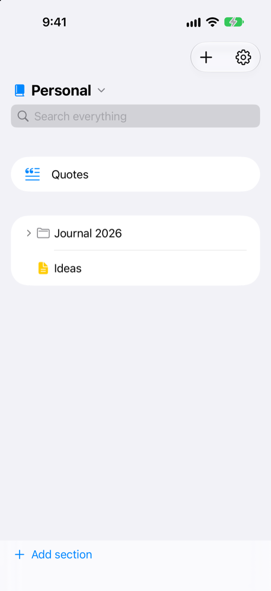
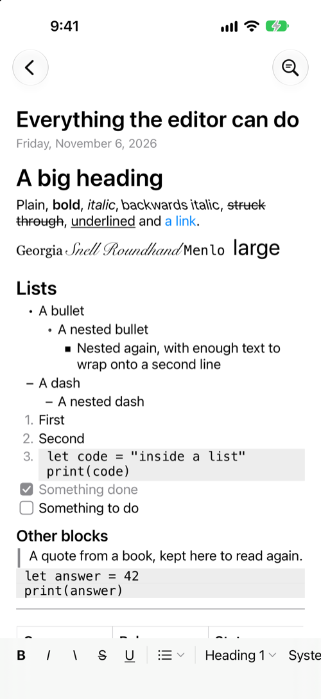
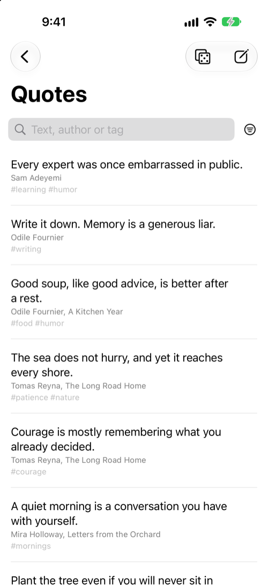

# Journal

A native journal and quote library for iPhone and Mac, written in Swift and SwiftUI. Notes are organized the way a paper binder is: notebooks, section groups, sections and pages. Everything is stored on the device, and search runs there too.

I built it to replace the mix of note apps I was using, and because none of them offered backwards italics.

This repository is a snapshot of the local-only version, and it won't be updated. Work on the app continues privately. All notebooks and quotes in the screenshots and sample data are made up.

| Notebook | Editor | Quotes |
| --- | --- | --- |
|  |  |  |

## What it does

- **Notebook tree:** notebooks, nested section groups, sections and pages, with colors, one notebook in view at a time, and page duplication.
- **Rich text editor:** bold, italic, backwards italic, strikethrough, underline, fonts, sizes, links, headings, nested lists, checklists, tables, code blocks, quotes and dividers.
- **Typed shortcuts:** starting a line with `*`, `-`, `-0` or `1.` begins a bullet, dash, checklist or numbered list.
- **Rich paste:** pasted formatting, lists and tables are converted into the app's page format.
- **Quote library:** quick capture, search by text, author or tag, a random quote, saving selected page text as a quote, and inserting a quote into a page.
- **Search:** one box searches pages and quotes as you type, across everything or within one notebook, section group or section. Find on page is separate.
- **Themes:** match system, light, dark and midnight navy.

## How it's built

| Part | What it holds |
| --- | --- |
| `JournalApp/` | The SwiftUI app: three columns on Mac, drill-down screens on iPhone |
| `Packages/JournalCore/` | Models, the SQLite database through [GRDB](https://github.com/groue/GRDB.swift), migrations, search and the page format |
| `Packages/JournalEditor/` | The TextKit 2 editor, conversion to and from the page format, and paste handling |
| `Spikes/BackwardItalics/` | The small throwaway test that proved backwards italics would work before anything else was built |

## Design decisions

**Pages are versioned JSON blocks, not Markdown.** Markdown can't hold fonts, sizes, underline or backwards italics, and adding them would mean inventing a private dialect anyway. A version number lets older pages be read correctly as the format grows.

**Backwards italics are a skewed font.** A negative `.obliqueness` text attribute stayed upright when tested, so the lean is built into the font with a Core Text transform. Testing this first, in the spike, kept the riskiest requirement from surfacing late.

**Tables are placed over the text by hand.** Text systems have no table that works on both iOS and macOS. Apple's attachment view provider never loaded its view in testing, so a table is an attachment that holds a blank space, and a SwiftUI grid is positioned over it after each layout.

**The search index can be thrown away.** Search uses SQLite FTS5 tables that are built from the pages and quotes, so they can be rebuilt at any time and are never the source of truth.

**Search uses a plain text field, not `.searchable`.** On iPhone, a screen opened from `.searchable` results stopped receiving updates, so edits appeared on screen but never saved. I found this by running the app in the simulator and checking the database directly.

**One app target for both devices.** SwiftUI shares the screens. Differences between the devices, such as the text view underneath the editor, are handled in small platform-specific blocks.

## Try it

You need Xcode with the iOS 18 and macOS 15 SDKs. No paid Apple account is needed for the Mac or the simulator.

Open `JournalApp.xcodeproj`, choose the `JournalApp` scheme, and run it. To start with the made-up sample journal, add these launch arguments under Product > Scheme > Edit Scheme > Run > Arguments. They only work in debug builds, and nothing is saved:

```
--in-memory
--seed-sample
```

To run the tests:

```bash
cd Packages/JournalCore && swift test
```

```bash
cd Packages/JournalEditor && swift test
```

## Status

Tested on Mac and in the iPhone simulator, not yet on a physical iPhone. Pasting from other apps has only been partly tried with real content. Not in this version: iCloud sync, images and file attachments, and export.

## Built with Claude

I built this with [Claude Code](https://claude.com/claude-code) while learning Swift, coming from Python. I set the requirements, chose between the options, and tested the app. Claude wrote the code and explained how it works.

## License

No license is included, so all rights are reserved. You're welcome to read the code.
